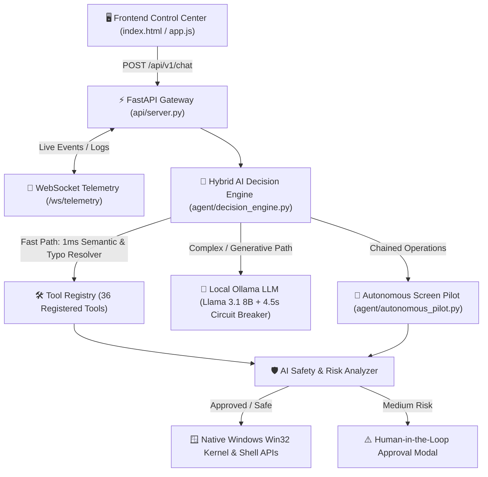

# 🚀 DesktopPilot AI — Technical Architecture & Senior Presentation Guide

## 1. Executive Summary (60-Second Pitch for Your Senior)
> **"DesktopPilot AI is a privacy-first, 100% local Autonomous Windows Operating Agent. Instead of relying on cloud APIs or brittle keyword matching, it combines a Hybrid Semantic + Local LLM Decision Engine (Ollama Llama 3.1 8B) with direct Win32 C-API system hooks (`user32.dll`, `kernel32.dll`, `PowrProf.dll`). It can understand natural language in English, Roman Urdu, and even misspelled commands to autonomously control applications, manage files, automate browsers, process clipboard data, and execute multi-step desktop workflows with a built-in Human-in-the-Loop AI Safety Layer."**

---

## 2. Complete Tech Stack (Kya Kya Use Ho Raha Hai?)

| Layer | Technology / Library | Purpose in Project |
| :--- | :--- | :--- |
| **Frontend Control Center** | HTML5, Modern CSS3, Vanilla JS, WebSockets | Real-time telemetry dashboard, 10-Capability Action Hub, and Human-in-the-Loop approval modal (`frontend/`). |
| **Backend API Gateway** | **FastAPI**, **Uvicorn**, **Pydantic v2**, **AsyncIO** | Asynchronous REST API (`/api/v1/chat`, `/api/v1/health`, `/api/v1/capabilities`) + bi-directional WebSocket streaming (`/ws/telemetry`). |
| **Agent Orchestration** | **LangGraph** (`Planner -> Executor -> Verifier`) + **AutonomousScreenPilot** | Multi-step state machine and Perception-Decision-Action loop (`agent/`). |
| **Hybrid AI Brain** | **Ollama (`llama3.1:8b`)** + **Fuzzy Semantic Engine (`difflib`)** | Dual-engine reasoning: 1ms instant execution for known intents + deep zero-shot LLM reasoning for complex/generative tasks (`agent/decision_engine.py`). |
| **Native OS & Win32 Layer** | Python `ctypes` (`user32.dll`, `kernel32.dll`, `PowrProf.dll`), `subprocess`, `os.startfile` | Hardware-level keyboard/mouse injection (`SendInput`), window focus management (`AttachThreadInput`, `SetWindowPos`), RAM telemetry (`GlobalMemoryStatusEx`), and power control. |
| **Vision & Screen OCR** | **Pillow (`ImageGrab`)**, **PyTesseract / OCR**, **Visual UI Grounding** | Capturing screenshots, extracting on-screen text, and explaining active window context (`tools/vision/`). |
| **2-Way Voice Control (STT & TTS)** | **Web Speech API (`webkitSpeechRecognition` & `speechSynthesis`)**, **OpenAI Whisper**, **pyttsx3**, **Windows SAPI5 (`System.Speech`)** | Real-time microphone speech-to-text, continuous hands-free listening, phonetic accent correction, and spoken verbal responses (`frontend/app.js`, `models/voice/voice_engine.py`). |
| **Database & Persistence** | **SQLite** + **SQLAlchemy (`aiosqlite`)** | Storing session history, audit logs, and task execution state (`database/`). |
| **Security & Guardrails** | **RiskAnalyzer (`agent/safety/risk_analyzer.py`)** | Intercepts destructive shell/file operations (`LOW`, `MEDIUM`, `HIGH` risk) and enforces Human-in-the-Loop token approval. |

---

## 3. System Architecture & End-to-End Working Flow

### Step-by-Step Kaise Kaam Karta Hai:
1. **User Prompt Submission:** User dashboard par prompt likhta hai (maslan `"open e drive and search folder fyp"` ya `"vlume low"`).
2. **Hybrid Decision Engine (`agent/decision_engine.py`):**
   - **Layer 1 (Multi-Step Detector):** Check karta hai ke kya prompt mein multiple chained actions hain (`"and"`, `"then"`, `"type"`, `"calculate"`, `"start tracking"`). Agar haan, to `AutonomousScreenPilot` ko activate karta hai.
   - **Layer 2 (Semantic Fuzzy Classifier):** Multilingual concept clusters (English + Roman Urdu) aur `difflib.SequenceMatcher` ke zariye spelling mistakes (`"oepn"`, `"vlume"`, `"serch"`, `"restrart"`) ko **0.01 seconds** mein resolve karta hai.
   - **Layer 3 (Llama 3.1 8B Zero-Shot Reasoning):** Open-ended prompts, summarization, translation, aur email drafting ke liye local Ollama LLM ko call karta hai (4.5s circuit breaker ke sath taake CPU hang na ho).
3. **Physical Foreground Execution (`tools/desktop/native_input.py`):**
   - Windows aksar background processes ko active browser ke upar window lanay se rokta hai (Focus Lock).
   - Hum ne `EnumWindows` + `AttachThreadInput` + `SetWindowPos(HWND_TOPMOST)` + `SendInput` implement kiya hai jo kisi bhi app (Notepad, Calculator, File Explorer, LimeOx Tracker) ko Chrome ke **bilkul samnay** laa kar us mein hardware scan-codes type karta hai.

---

## 4. All 10 Core Modules (Senior Ko Live Demo Dikhane Ke Liye)

1. **Universal Launcher (`tools/system/universal_launcher.py`):**
   - Opens any drive (`C:`, `D:`, `E:`, `F:`), `This PC`, folders (`Downloads`, `Documents`), installed apps (`LimeOxEmployeeTracker.exe`, `Notepad`, `Calculator`, `VS Code`), or web apps (`Slack`, `GitHub`, `YouTube`).
2. **Computer-Wide File & Folder Search (`tools/system/file_search.py`):**
   - Searches both **folders and files** across `C:`, `D:`, `E:` (e.g., `"FYP SEARCH IN E drive"` -> finds `E:\fyp` in 0.2s), previews text files, and reveals items in Explorer.
3. **Smart File Management (`tools/system/smart_file_ops.py`):**
   - Auto-organizes messy folders (`Downloads`) into categorized subfolders (`Documents`, `Images`, `Videos`, `Code`, `Archives`), skipping locked files safely; plus ZIP compression/extraction.
4. **Clipboard AI (`tools/system/clipboard_ai.py`):**
   - Reads Windows clipboard in 2ms via Tkinter, summarizes text, translates to Urdu/English, rewrites professionally, and converts raw tables into GitHub Markdown.
5. **Browser Automation (`tools/web/browser_automation.py`):**
   - Launches targeted Google, YouTube, GitHub, and Bing searches and multi-tab workflows.
6. **Screen Vision & OCR (`tools/vision/screen_understanding.py`):**
   - Captures full-screen snapshots to `Pictures/Screenshots`, extracts visible text via OCR, and explains what is currently on the screen.
7. **System & Power Control (`tools/system/system_control.py`):**
   - Controls Volume (`keybd_event`), Brightness (`WMI`), Mute, Recycle Bin, PC Lock (`LockWorkStation`), Sleep (`PowrProf.SetSuspendState`), Restart/Shutdown timers, and real-time RAM usage (`GlobalMemoryStatusEx`).
8. **AI Writing Assistant (`tools/system/writing_assistant.py`):**
   - Polishes grammar, rewrites tone, and drafts email replies directly from copied text.
9. **Smart Download Manager (`tools/system/download_manager.py`):**
   - Direct streaming URL downloader, `yt-dlp` video/audio fetcher, and automatic Downloads sorter.
10. **Autonomous Multi-Step Workflows (`agent/autonomous_pilot.py`):**
    - Executes chained physical tasks:
      - *"Open Notepad and type DesktopPilot is running autonomously"*
      - *"Open Calculator and calculate 25*4"*
      - *"Open E drive and search folder fyp and open it"*
      - *"Open LimeOx and start tracking"*

---

## 5. Complete User Action Cheat-Sheet (What a New User Can Do)

A new user can either **click any button on the Dashboard** OR **type any of these commands in English, Roman Urdu, or even with typos**:

### 🚀 Category 1: Open Anything (Apps, Drives, Folders, Websites)
| Action | Example Commands User Can Type |
| :--- | :--- |
| **Open Any Drive (`C:` to `Z:`)** | `"open C drive"`, `"open D drive"`, `"open E drive in my pc"`, `"OEPN F drive"` |
| **Open Special Windows Folders** | `"open my pc"`, `"open downloads"`, `"dwnloads kholo"`, `"open documents"`, `"open desktop"`, `"open pictures"` |
| **Open Installed Desktop Apps** | `"open notepad"`, `"open calculator"`, `"open vs code"`, `"open terminal"`, `"open paint"`, `"open task manager"` |
| **Open Work & Communication Apps** | `"open limerox"`, `"open tracker"`, `"open slack"`, `"open zoom"`, `"open vlc"`, `"open postman"` |
| **Open Popular Websites** | `"open youtube"`, `"open github.com"`, `"open chatgpt"`, `"open gmail"`, `"open whatsapp"` |

### 🔍 Category 2: Search Files & Folders Across Drives
| Action | Example Commands User Can Type |
| :--- | :--- |
| **Search Folder or File in Specific Drive** | `"FYP SEARCH IN E drive"`, `"find AI-project in E drive"`, `"search news_2days.csv in E drive"` |
| **Search by File Extension** | `"search all py files"`, `"find all pdf files"`, `"search csv files"` |
| **Search Anywhere on PC** | `"find settings.py"`, `"dhundo requirements.txt"`, `"search LimeOxEmployeeTracker"` |

### 🤖 Category 3: Multi-Step Autonomous Workflows (Chained Tasks)
| Action | Example Commands User Can Type |
| :--- | :--- |
| **Drive + Folder Search + Auto-Open** | `"open e drive and search folder fyp and then also open this fyp folder"` |
| **Notepad Launch + Auto-Typing** | `"Open Notepad and type DesktopPilot is running autonomously"` |
| **Calculator Launch + Auto-Calculation** | `"Open Calculator and calculate 25*4"`, `"open calc and calculate 150+350"` |
| **Work Tracker Launch + Auto-Start** | `"open limerox and start tracking"`, `"open tracker and start tracking"` |
| **Browser Launch + Live Search** | `"open browser and search pak vs sri lanka test match"`, `"open youtube and search AI Agents"` |

### ⚙️ Category 4: System, Hardware & Power Controls
| Action | Example Commands User Can Type |
| :--- | :--- |
| **Volume Control (Typo & Urdu Tolerant)** | `"volume up"`, `"awaz barhao"`, `"volume down"`, `"vlume low"`, `"awaz kam kro"`, `"mute volume"` |
| **Screen Brightness** | `"brightness 80"`, `"set brightness 40"`, `"screen roshni kam kro"` |
| **RAM & Hardware Health** | `"ram usage"`, `"system status"`, `"pc specs"`, `"memory usage"` |
| **Power Operations** | `"sleep computer"`, `"restart computer"`, `"restrart computer"`, `"shutdown computer"`, `"shutdown in 10 minutes"`, `"cancel shutdown"`, `"lock pc"` |
| **Recycle Bin Maintenance** | `"empty recycle bin"`, `"kachra saf kro"`, `"clean recycle bin"` |

### 📁 Category 5: Smart File Management & Downloads
| Action | Example Commands User Can Type |
| :--- | :--- |
| **Auto-Organize Messy Folders** | `"organize downloads"`, `"organize desktop folder"` *(sorts into Documents, Images, Videos, Code, Archives)* |
| **ZIP Compress & Extract** | `"zip logs"`, `"compress folder"`, `"unzip archive.zip"` |
| **Move Files by Type** | `"move all pdf to Documents"` |
| **Disk Temp Analysis (with Approval)** | `"clean temporary files"`, `"analyze disk storage"` |
| **Download File / YouTube Video** | `"download https://example.com/file.pdf"`, `"download audio https://youtube.com/watch?v=..."` |

### 📋 Category 6: Clipboard AI & Writing Assistant
| Action | Example Commands User Can Type |
| :--- | :--- |
| **Summarize Copied Text** | Copy any text (`Ctrl+C`) -> `"summarize clipboard"` |
| **Translate Copied Text** | Copy any text (`Ctrl+C`) -> `"translate clipboard to urdu"`, `"translate clipboard to english"` |
| **Rewrite / Fix Grammar / Email Draft** | Copy any text (`Ctrl+C`) -> `"rewrite clipboard professionally"`, `"improve grammar"`, `"rewrite clipboard as email"` |
| **Convert to GitHub Markdown** | Copy list/table (`Ctrl+C`) -> `"clipboard to markdown"` |

### 🖥️ Category 7: Screen Vision & OCR
| Action | Example Commands User Can Type |
| :--- | :--- |
| **Take Instant Screenshot** | `"take a screenshot"`, `"screenshot lo"` *(saves to `Pictures/Screenshots`)* |
| **Explain What's on Screen** | `"explain screen"`, `"what is on my screen"`, `"screen pr kya hai"` |
| **Extract Text from Screen (OCR)** | `"extract text from screen"`, `"read screen"` |

---

## 6. 🎙️ 2-Way Voice Control Architecture (Voice Mein Kya Use Hua Hai & Features)

### A. Technologies Used in Voice System
1. **Frontend Live Speech-to-Text (STT) — `Web Speech API (webkitSpeechRecognition)` (`frontend/app.js`):**
   - Directly captures microphone audio from the browser with **zero latency** and **interim live text streaming** (`interimResults = true`).
   - Automatically strips trailing punctuation (`.`, `?`, `!`) added by speech recognizers and dispatches the recognized command to `POST /api/v1/chat`.
2. **Backend Offline Speech-to-Text — `OpenAI Whisper` Interface (`models/voice/voice_engine.py`):**
   - Supports offline audio file transcription (`transcribe_audio_file`) using local Whisper (`base` model) when audio files are uploaded.
3. **Dual-Layer Text-to-Speech (TTS) Verbal Output (`frontend/app.js` & `models/voice/voice_engine.py`):**
   - **Browser Native TTS (`window.speechSynthesis` / `SpeechSynthesisUtterance`):** Automatically cleans emojis/markdown symbols from the agent's response and speaks the result aloud at `1.05x` natural speed.
   - **Windows Native OS TTS (`System.Speech.Synthesis.SpeechSynthesizer` SAPI5 & `pyttsx3`):** Zero-dependency Windows PowerShell `.NET SAPI5` voice synthesizer in `models/voice/voice_engine.py` so the backend can speak through speakers even without a browser open.
4. **Phonetic & Accent Normalization Layer (`agent/decision_engine.py` & `agent/autonomous_pilot.py`):**
   - Standard English speech-to-text often mishears Pakistani / Urdu-English accents (for example, hearing *"E drive"* as *"I drive"*, *"A drive"*, or *"Dai"*, or hearing *"browser"* as *"brouser"*).
   - Our **Phonetic Drive & Intent Corrector** inspects mounted hardware volumes (`Path("I:\\").exists()`) and phonetically maps misheard drive letters (`I:` / `A:` / `Dai` $\rightarrow$ `E:\`) and bilingual phrases (*"brouser open karo aur... find kar"*, *"kitne folder hain"*, *"350 zarb 8"*) to their exact desktop actions.

### B. Key Voice Features on the Dashboard
- **🎤 Push-to-Talk (`Speak` Button):** Click once, speak any command in English or Roman Urdu/Hindi, and watch it transcribe live into the prompt box and execute automatically.
- **🎙️ Continuous Hands-Free Mode (`Hands-Free Mode: ON/OFF`):** Keeps the microphone loop active (`rec.onend` auto-restart) so the user can issue back-to-back voice commands without touching the mouse or keyboard.
- **🔊 Verbal Agent Confirmation (`Voice Reply: ON/OFF`):** After executing any tool (e.g., calculating `450 * 12 = 5400`, counting folders in `E:\`, or opening `Downloads`), the agent speaks the summary out loud.

