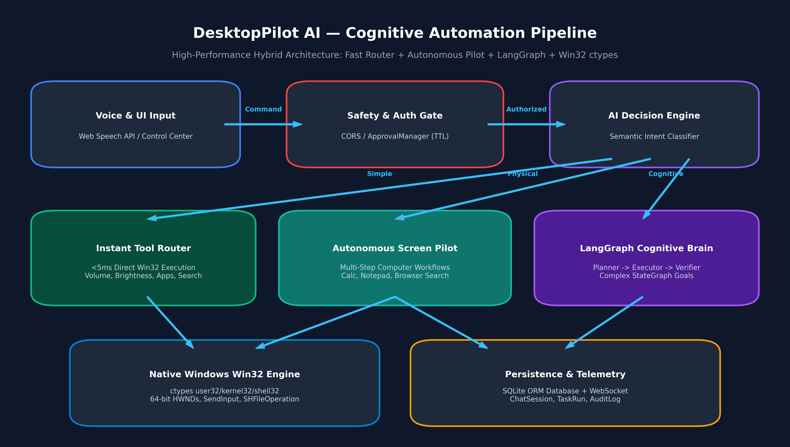
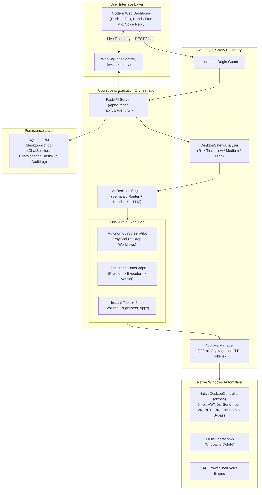

# DesktopPilot AI 🚀
### Voice-Enabled Autonomous Windows Desktop Operating Agent

[](https://opensource.org/licenses/MIT)
[](https://www.python.org/downloads/)
[](https://fastapi.tiangolo.com/)
[](https://microsoft.com/windows)
[-brightgreen.svg)]()

> **DesktopPilot AI** is an advanced, production-hardened autonomous desktop assistant that transforms natural spoken language and chat commands into precise, native Windows operations. It combines high-speed heuristic routing with a cognitive **LangGraph StateGraph** (Planner → Executor → Verifier) pipeline, cryptographically enforced Human-in-the-Loop safety, and zero-install Win32 automation.

---

## 🏛️ System Pipeline Architecture



---

## 🌟 Key Features & Capabilities

DesktopPilot AI is organized into **10 Core Capability Suites** with **51 registered tools**:

1. **🚀 Open Anything:** Applications, Websites, Explorer Drives (`C:`, `D:`, `E:` with phonetic STT normalization for Urdu/English accents), `This PC`, and Start Menu shortcuts.
2. **🔍 Search Files & Folders:** Sub-second recursive directory scanning with Explorer reveal and preview.
3. **📁 Smart File Management:** Copy, move, rename, Zip/Unzip (with Zip Slip traversal defense), and folder categorization.
4. **📋 Clipboard AI:** Instant Tkinter reading/writing with local fallback ladders for summarization, translation (English ↔ Urdu), rewriting, and Markdown formatting.
5. **🌐 Browser Automation:** Automated searches on Google, YouTube, GitHub, and Bing with multi-tab workflow coordination.
6. **🖥️ Screen Understanding & Vision:** Desktop screenshots, OCR extraction, screen analysis, and visual UI element grounding.
7. **⚙️ Native System Control:** Volume, brightness, mute, RAM telemetry (`GlobalMemoryStatusEx`), Recycle Bin purge, and power management with confirmation gates.
8. **✍️ AI Writing Assistant:** In-app grammatical polish, professional tone refactoring, and auto-reply drafting.
9. **⬇️ Download Manager:** Direct URL file acquisition, video downloading via `yt-dlp`, and auto-organizing Downloads.
10. **🤖 Multi-Step Autonomous Workflows:** Chained computer operations (e.g., *Launch Calculator $\rightarrow$ focus window $\rightarrow$ enter calculation $\rightarrow$ extract result*).

---

## 🛡️ Enterprise Security & Safety Architecture

- **Command Injection Neutralization:** Shell execution sanitization blocking illegal metacharacters (`&`, `|`, `;`, `$`, `` ` ``).
- **Safe Recoverable Deletion:** Mandatory user confirmation tokens before deletion, using native Windows Recycle Bin (`SHFileOperationW` with `FOF_ALLOWUNDO = 0x0040`).
- **PowerShell TTS Subexpression Neutralization:** Base64-encoded payload transmission preventing `$()` command execution in speech synthesizer calls.
- **Strict Local CORS:** Restricts origin access strictly to trusted localhost addresses (`localhost:8000`, `127.0.0.1:8000`, `localhost:3000`).
- **Cryptographic Human-in-the-Loop (`ApprovalManager`):** 128-bit single-use tokens with TTL (300s) enforcing user approval on sensitive operations (reboot, disk cleanup, folder deletion).

---

## 🏗️ System Architecture



---

## 🚀 Quick Start Guide

### Prerequisites
- **Operating System:** Windows 10 or Windows 11 (64-bit).
- **Python:** Python 3.10 to 3.13 (64-bit recommended).
- **Optional Local LLM:** [Ollama](https://ollama.com/) running `llama3.1:8b` (built-in deterministic fallbacks ensure 100% functionality without Ollama).

### Installation

1. **Clone the repository:**
   ```bash
   git clone https://github.com/yourusername/desktoppilot-ai.git
   cd desktoppilot-ai
   ```

2. **Create and activate a virtual environment:**
   ```powershell
   python -m venv venv
   .\venv\Scripts\Activate.ps1
   ```

3. **Install dependencies:**
   ```bash
   pip install -r requirements.txt
   ```

4. **Launch DesktopPilot AI:**
   Double-click `START_DESKTOPPILOT.bat` or run:
   ```bash
   python run_backend.py
   ```
   Open your browser to: **`http://localhost:8000`**

---

## 🧪 Testing & Verification

DesktopPilot AI includes a comprehensive automated test suite verifying security, native Win32 automation, persistence, and multi-step execution:

```bash
# Run the complete test suite (33 unit tests)
python -m unittest discover -s tests -p "test_*.py" -v

# Run the 10 confusing / Roman-Urdu speech-to-text benchmark
python -m tests.test_10_confusing_prompts
```

**Test Verification Results:**
- Core Capabilities (Phase 1–3): **14/14 Passed**
- P0 Security & Win32 Primitives: **11/11 Passed**
- P1 Persistence & Approval Tokens: **4/4 Passed**
- P2 UI Element & Verifier Nodes: **4/4 Passed**
- Confusing Prompt Robustness: **10/10 Passed (100%)**

---

## 📁 Repository Structure

```
DESKTOP/
├── agent/                   # Cognitive orchestration & brains
│   ├── graphs/              # LangGraph StateGraph definitions
│   ├── nodes/               # Planner, Executor, and Verifier nodes
│   ├── safety/              # Risk analyzer and ApprovalManager (HITL)
│   ├── states/              # State schemas and message reducers
│   ├── autonomous_pilot.py  # AutonomousScreenPilot multi-step executor
│   └── decision_engine.py   # Semantic and heuristic intent classifier
├── api/                     # FastAPI backend & routes
│   ├── routes/              # REST & approval endpoints (/chat, /agent/run)
│   └── server.py            # FastAPI application & CORS configuration
├── config/                  # Settings and path configurations
├── database/                # Persistence layer (SQLAlchemy ORM + SQLite)
│   ├── models/              # ChatSession, ChatMessage, TaskRun, AuditLog
│   └── session.py           # Synchronous SQLite connection factory
├── frontend/                # Zero-dependency Web Control Center
│   ├── app.js               # ES6 app with push-to-talk & hands-free mic mutex
│   ├── index.html           # Modern responsive dashboard (51 tools)
│   └── style.css            # Dark mode glassmorphism UI styling
├── models/                  # Inference and voice engines
│   ├── ollama/              # LLM service with fast timeout circuit breaker
│   └── voice/               # Base64 SAPI speech synthesizer
├── tests/                   # Automated unit & regression test suites
│   ├── test_p0_security_and_automation.py
│   ├── test_p1_high_priority.py
│   ├── test_p2_features.py
│   ├── test_phase1_tools.py
│   ├── test_phase2_tools.py
│   ├── test_phase3_tools.py
│   └── test_10_confusing_prompts.py
├── tools/                   # 51 Registered OS automation tools
│   ├── desktop/             # Win32 ctypes input & window controller
│   ├── system/              # Launcher, file search, clipboard AI, power
│   ├── vision/              # Screen understanding, OCR, and visual click
│   ├── web/                 # Browser automation & multi-tab opener
│   └── registry.py          # Unified tool registry & execution dispatcher
├── utils/                   # Telemetry manager and logger
├── .env.example             # Example environment variables
├── .gitignore               # Clean git tracking boundaries
├── requirements.txt         # Production dependencies
├── run_backend.py           # Backend bootstrap script
└── START_DESKTOPPILOT.bat   # One-click Windows starter script
```

---

## 📜 License

This project is licensed under the MIT License — see the [LICENSE](LICENSE) file for details.

